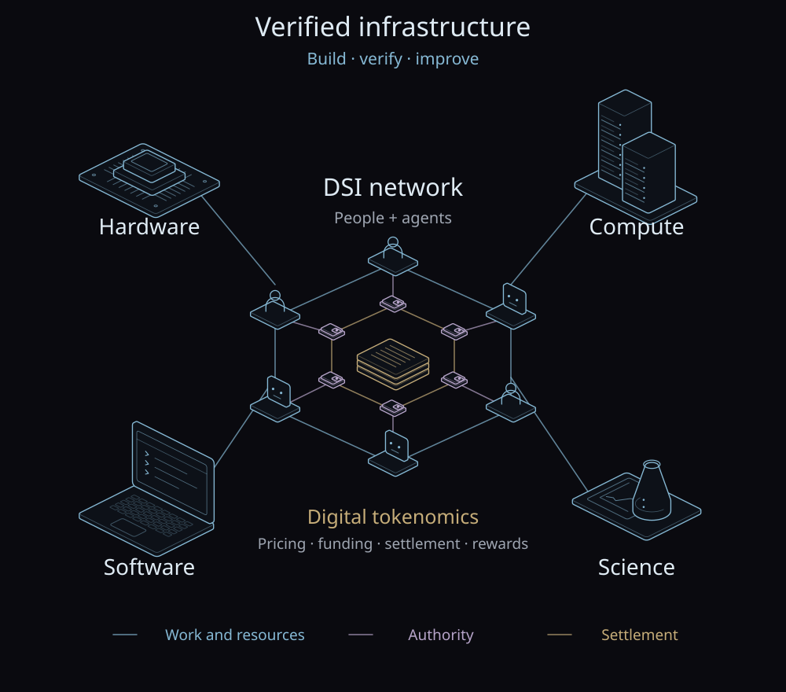

These notes study how decentralized superintelligence (DSI) and digital
tokenomics coordinate work and allocate physical and computational resources
among people and agents. The economic mechanisms under study include resource
pricing and funding, payment settlement, and rewards for contributions.

We develop formal models, specifications, executable code, and proofs natively in
[Lean 4](https://lean-lang.org/). The studies cover ledger transfers,
spending authorization, and payment retries; the current prototype implements
participant registries and a model of identifier collision probability.
External protocols provide reference designs for these studies.



The diagram shows the project’s research scope. Wallets, payments, incentives,
and chain settlement are subjects of study; they are not yet implemented in
the current participant-node prototype.

## Preliminaries

The preliminaries review reference protocols and define the objects used by
the payment studies.

- [Modules and interactions](../studies/Cases/PaidTask/System/Note.mdx): an overview of the
  environment and the relationships between its parts.
- [Quantities and units](../studies/Foundation/Quantities/Note.mdx):
  shared definitions for energy, time, asset amounts, nonces, and gas fees.
- [Blockchain infrastructure](../studies/Reference/Ethereum/Note.mdx): Bitcoin, Ethereum,
  and Solana: ledger state, transactions, account access, and fees.
- [Assets and tokens](../studies/Reference/ERC20/Note.mdx): stablecoins for
  pricing and payments, asset identity, and token balances and transfers.
- [Wallets and authorization](../studies/Native/Wallet/Note.mdx): PASS's wallet
  model and a concrete spending policy.
- [Payment protocols and infrastructure](../studies/Reference/X402/Note.mdx):
  x402 payment exchange, AP2 authorization, Circle Gateway settlement, and
  Nevermined metering and billing.
- [Agent communication](../studies/Reference/A2A/Note.mdx): Agent Cards, skills,
  interfaces, and task states.

## Examples

These worked examples retain the models and proofs from the
[recorded study revision](https://github.com/CloK-Lab/vdsi/tree/43f26201474a144b68924d2b485a0e3fd857c483).
They are separate from the current node runtime.

- [A paid task](../studies/Cases/PaidTask/Note.mdx): authorize a payment of 0.003 ETH,
  update balances in wei, and return an echo result.
- [One paid call](../studies/Cases/PaidCall/Note.mdx): reservation, settlement,
  refund, conservation of funds, and recovery from a lost reply without a second payment.

## Current implementation

- [Participant registries](../VDSI/Node/Note.mdx): independent node processes,
  duplicate rejection, snapshot exchange, and saved-state recovery.
- [Identifier collision probability](../VDSI/IdGeneration/Note.mdx): a proved
  birthday bound for independent uniform sampling. For at most one billion
  256-bit draws, collision probability is below $2^{-128}$. The runtime has no
  random ID generator yet.

Registries establish identity records for coordination. They do not establish
account ownership or monetary rules. The prototype currently has no blockchain,
consensus, wallet authority, payments, or token issuance and redemption.

## Run the prototype

[Install the toolchain](https://lean-lang.org/install/), then run:

```sh
git clone https://github.com/CloK-Lab/vdsi.git
cd vdsi
./scripts/check.sh
```

The check builds the core, runs its tests, and audits theorem assumptions.
[Participant registries](../VDSI/Node/Note.mdx#run-two-nodes) explains how to run
two nodes. Each payment example gives commands for its separate study checkout.
